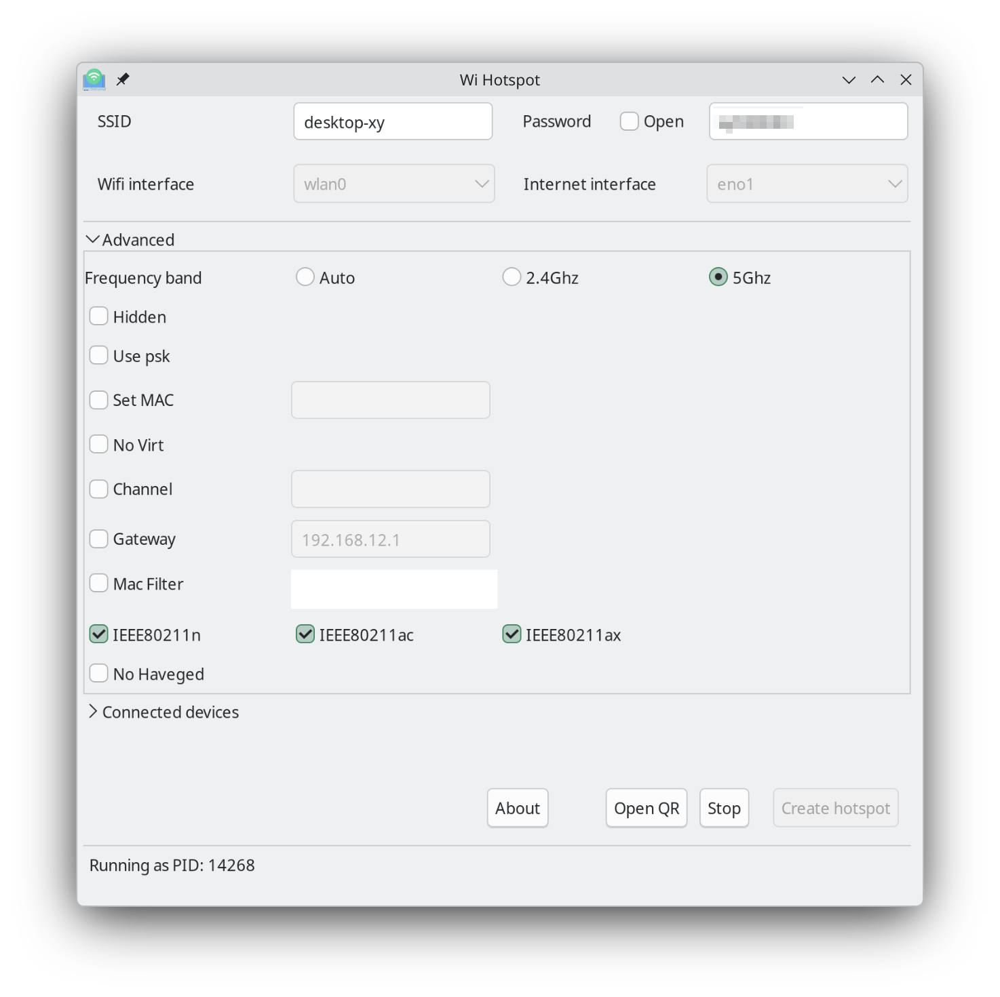

## KDE 开启的热点无网络

先关闭防火墙（如果有），仍然不行。经排查，是由于安装了 docker 导致的。执行下面的命令会发现，Chain FORWARD 的默认策略是 DROP：

```bash
sudo iptables -L FORWARD -n -v
```

输出如下：
```
Chain FORWARD (policy DROP 0 packets, 0 bytes)
 pkts bytes target     prot opt in     out     source               destination         
    0     0 DOCKER-USER  all  --  *      *       0.0.0.0/0            0.0.0.0/0           
    0     0 DOCKER-FORWARD  all  --  *      *       0.0.0.0/0            0.0.0.0/0
```

虽然后面经过折腾解决了，但感觉比较麻烦，而且 KDE 的热点速度也不快（比如不能选择使用 WiFi6），所以就放弃了 KDE 的热点，改为使用 Wifi Hotspot 这个工具来创建热点，速度快了很多，也不会和 docker 冲突了。



勾选上 `IEEE80211n`, `IEEE80211ac` 和 `IEEE80211ax`，就可以创建 WiFi6 热点了。有些网卡不支持 5Ghz，可以换成 2.4Ghz 的频段。

Arch Linux 上安装 Wifi Hotspot (archlinuxcn, AUR)：

```bash
paru -S linux-wifi-hotspot
```

## R7000p 混合显卡模式无法调整亮度

在 `/etc/default/grub` 的 `GRUB_CMDLINE_LINUX_DEFAULT` 行添加：
```conf
amdgpu.backlight=0
```
完整示例：
```conf
# GRUB_CMDLINE_LINUX_DEFAULT='nowatchdog nvme_load=YES zswap.enabled=0 loglevel=3 amdgpu.backlight=0'
```

然后更新 grub：
```bash
sudo grub-mkconfig -o /boot/grub/grub.cfg
```

## 网页驱动无法连接鼠标

在 CachyOS 上，VGN 蜻蜓 F1 SE 可以正常使用，但 [VGN HUB](https://hub.vgnlab.com.cn/#/) 无法连接，Windows 下则正常。检查发现，网页使用的 WebHID 接口对应 `/dev/hidraw*`，默认仅 root 有读写权限。

添加 udev 规则，允许当前用户访问含标准 USB 鼠标接口的设备：

```bash
sudo tee /etc/udev/rules.d/70-mouse-webhid.rules >/dev/null <<'EOF'
SUBSYSTEM=="hidraw", KERNEL=="hidraw*", ENV{ID_BUS}=="usb", ATTRS{bInterfaceClass}=="03", TAG+="uaccess"
EOF
sudo udevadm control --reload-rules
```

拔插鼠标或接收器后，用 Chrome 刷新网页，重新连接并授权即可。Firefox 不支持 WebHID。

不方便拔插时，可执行以下命令，让已连接的 HID 设备重新应用规则：

```bash
sudo udevadm trigger --action=change --subsystem-match=hidraw
```

此规则适用于多数有线鼠标和 2.4G 接收器，不覆盖蓝牙及部分非标准鼠标。它会授权同一设备的全部 HID 接口，键鼠共用接收器的键盘接口也包含在内。

## TF 卡读取时，PCIe 读卡器大量报 Timeout

### 症状

在 CachyOS 上，Realtek RTS522A PCIe 读卡器（设备 ID `10ec:522a`）读取 TF 卡时，内核持续报告以下错误：

```text
rtsx_pci 0000:02:00.0: PCIe Bus Error: severity=Correctable, type=Data Link Layer, (Transmitter ID)
rtsx_pci 0000:02:00.0:   device [10ec:522a] error status/mask=00001000/00006000
rtsx_pci 0000:02:00.0:    [12] Timeout
```

### 排查步骤

**1. 找到读卡器的设备地址：**

方法一：

```bash
lspci -Dnnk
```

在输出中寻找包含 `Card Reader` 或读卡器型号的条目，并查看紧随其后的 `Kernel driver in use`。本案例的输出如下：

```text
0000:02:00.0 Unassigned class [ff00]: Realtek Semiconductor Co., Ltd. RTS522A PCI Express Card Reader [10ec:522a] (rev 01)
    Subsystem: Lenovo Device [17aa:3939]
    Kernel driver in use: rtsx_pci
    Kernel modules: rtsx_pci
```

这一条目的第一列 `0000:02:00.0` 就是设备地址。

方法二：

如果已经确认芯片是 RTS522A，也可以按设备 ID 筛选，第一列即为设备地址：

```bash
lspci -Dnnk -d 10ec:522a
```

**2. 检查错误计数：**

以下命令假设设备地址为： `0000:02:00.0`，请根据实际情况替换。

查看错误计数：

```bash
cat /sys/bus/pci/devices/0000:02:00.0/aer_dev_correctable
```

持续读取 TF 卡时，观察 `Timeout` 是否增长：

```bash
watch -n 1 cat /sys/bus/pci/devices/0000:02:00.0/aer_dev_correctable
```

如果没有错误，应输出类似如下内容：

```text
RxErr 0
BadTLP 0
BadDLLP 0
Rollover 0
Timeout 0
NonFatalErr 0
CorrIntErr 0
HeaderOF 0
TOTAL_ERR_COR 0
```

### 临时关闭读卡器 ASPM

ASPM（Active State Power Management）是 PCIe 链路省电机制，允许链路在空闲时进入 L0s、L1 等低功耗状态。部分设备、固件或驱动可能存在兼容性问题。设备显示 `D0` 并不表示 ASPM 已关闭：设备电源状态与链路电源状态是不同层面的机制。

先查看读卡器提供的开关：

```bash
ls /sys/bus/pci/devices/0000:02:00.0/link/
```

本例中，以下四项均存在且初始值为 `1`。可以先临时关闭：

```bash
for state in l1_2_aspm l1_1_aspm l1_aspm l0s_aspm; do
  echo 0 | sudo tee "/sys/bus/pci/devices/0000:02:00.0/link/$state"
done
```

检查是否关闭成功：

```bash
for state in l0s_aspm l1_aspm l1_1_aspm l1_2_aspm; do
  printf '%s=' "$state"
  cat "/sys/bus/pci/devices/0000:02:00.0/link/$state"
done
```

然后再对 TF 卡进行读取测试并观察错误计数。如果错误不再增长，说明问题与 ASPM 相关。此时可以考虑持久化设置。

### 持久化设置与验证

本案例采用 GRUB，以下持久化步骤适用于使用 GRUB 的系统。编辑配置：

```bash
sudoedit /etc/default/grub
```

在 `GRUB_CMDLINE_LINUX_DEFAULT` 的引号内保留原有参数，并追加：

```text
pcie_aspm.policy=performance
```

然后生成配置并重启（此路径适用于本例的 CachyOS/GRUB 安装，其他发行版需确认配置路径）：

```bash
sudo grub-mkconfig -o /boot/grub/grub.cfg
```

重启后验证：

```bash
cat /proc/cmdline
# 应包含 `pcie_aspm.policy=performance`

cat /sys/module/pcie_aspm/parameters/policy
# 方括号应选中 performance，例如：
# default [performance] powersave powersupersave

cat /sys/bus/pci/devices/0000:02:00.0/link/l1_aspm
# 应为 0，表示已关闭 ASPM
```

## CachyOS 笔记本长时间睡眠后，偶尔唤醒很慢、打开程序很慢、磁盘忙碌率 100%、读写速率很低

诊断时发现：

- 系统采用 Btrfs 文件系统，根分区为 NVMe SSD。
- 唤醒后 `fstrim.service` 立即运行，`fstrim` 处于等待 I/O 的 D 状态。
- 服务用时约 19 分 44 秒，结束时报告对根分区提交了约 52.5 GiB 的 TRIM。
- 服务完成后，D 状态进程消失，I/O wait 降至约 0–2%。Btrfs 设备错误计数全为 0，日志未发现 NVMe I/O 错误。

怀疑是 `fstrim` 导致硬盘卡顿，关闭方式如下：

```bash
sudo systemctl disable --now fstrim.timer
```

> fstrim.service 由 fstrim.timer 定时触发，默认每周运行一次。它会扫描整个文件系统，向支持 TRIM 的块设备发送 TRIM 命令，以告知哪些块不再使用，从而帮助 SSD 回收空间和优化性能。  
> CachyOS 的 btrfs 的默认挂载选项配置了 `discard=async` 本身就会在后台异步发送 TRIM 命令，所以不需要再使用 fstrim.timer。

